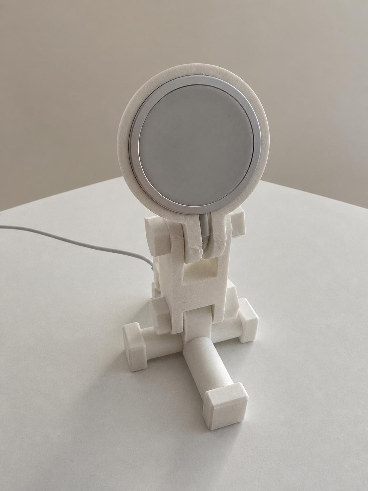
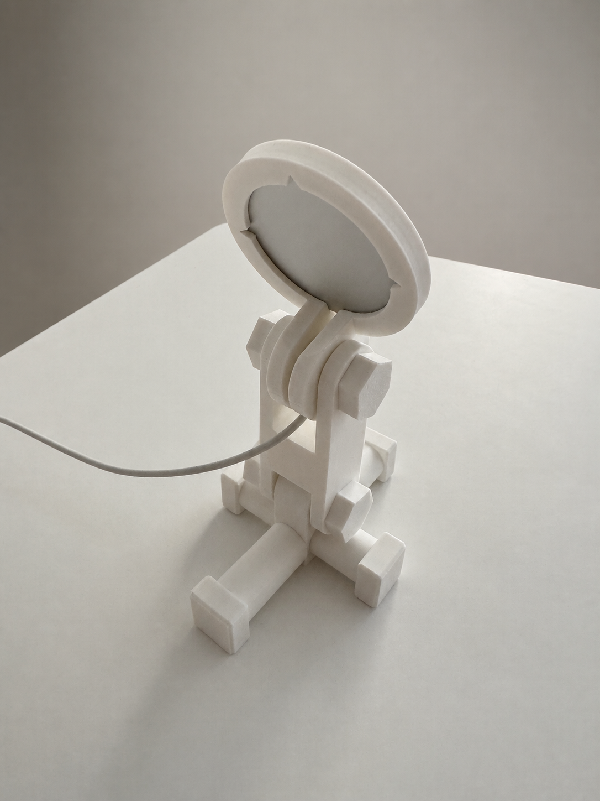
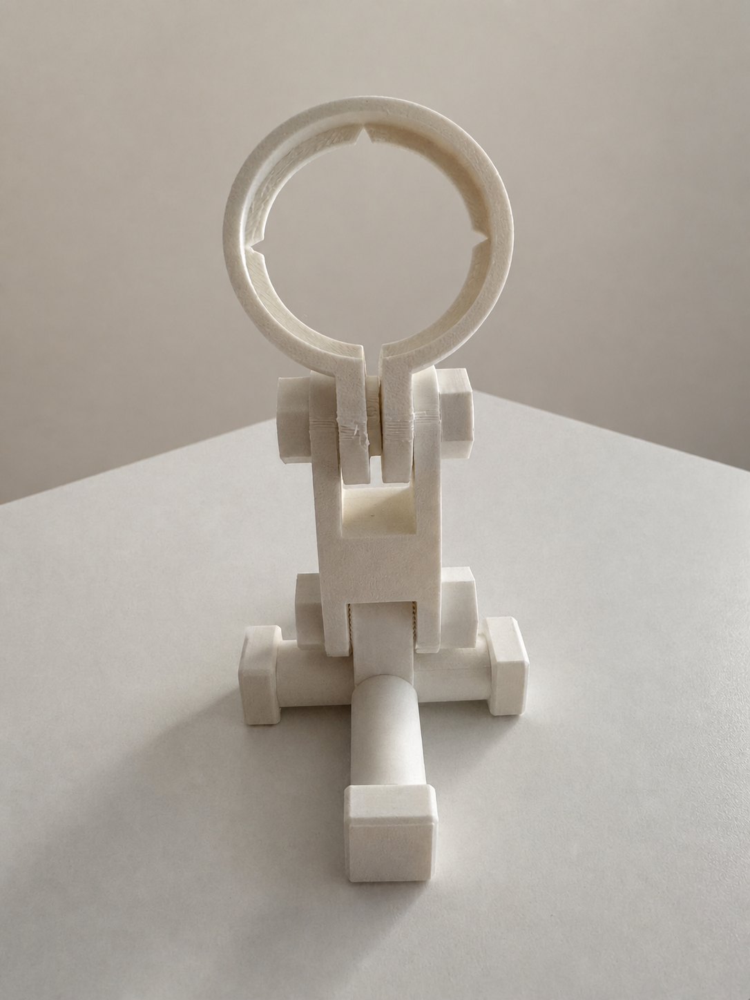

# Modular MagSafe Holder

## Project status

Version **0.2** provides both **Full-Height** and **Compact** configurations.
The stand has been assembled and tested as a functional desktop MagSafe holder.
It holds an official Apple MagSafe Charger securely and allows the phone to be
removed without pulling the charger out of its retaining ring.

The project is designed in OpenSCAD as a modular construction system. Individual
parts can be adjusted, reprinted, and replaced without rebuilding the entire
stand.

## Version 0.2

The current source provides two selectable configurations while keeping the
version 0.1 artifacts unchanged under
[`releases/v0.1/`](releases/v0.1/):

- `full_height` keeps the original elevated central cross and four integrated
  attachment studs;
- `compact` reduces the central base to a 24 mm indexed lug, moves the remaining
  perpendicular studs onto the joint axis, and replaces the lower bolt with a
  44 mm shared stud. The shared stud has two 8 mm threaded ends and a 28 mm
  smooth center, so it joins the lower support fork and carries both lateral
  sleeves on the same axis. Its two integrated perpendicular studs retain an
  8 mm external thread length while extending approximately 2 mm into the
  rounded lug to form a continuous, reinforced joint.

Both configurations use complementary radial indexing between the MagSafe
clamp arms and the upper support fork. The Compact configuration has been
printed and assembled successfully. A slight rocking motion was observed on the
test surface; double-sided mounting tape, with a second layer under one foot,
provided a simple and effective correction. This practical observation is kept
as part of the version 0.2 release rather than hidden by an untested redesign.

### Version 0.2 artifacts

Every printable component is available as an individual STL. The seven files
shared by both configurations are stored under
[`shared/stl/`](releases/v0.2/shared/stl/), while configuration-specific parts are under
[`full-height/stl/`](releases/v0.2/full-height/stl/) and
[`compact/stl/`](releases/v0.2/compact/stl/). Use the shared STL files
together with the selected configuration directory.

Ready-to-open Bambu Studio projects are also provided for both configurations:

- [full-height project for the Bambu Lab A1 mini](releases/v0.2/full-height/bambu/magsafe_holder_full_height_v0.2_a1_mini.3mf);
- [compact project for the Bambu Lab A1 mini](releases/v0.2/compact/bambu/magsafe_holder_compact_v0.2_a1_mini.3mf).

### Full-height Bambu Studio project

The full-height project contains the complete 19-piece configuration on one
plate:

| Part | Quantity |
| --- | ---: |
| Indexed MagSafe clamp ring | 1 |
| Vertical support | 1 |
| Full-height threaded base | 1 |
| Long sleeve | 2 |
| Short sleeve | 2 |
| Threaded end block | 4 |
| M12 hex-socket connector | 4 |
| M12 long bolt | 2 |
| M12 nut | 2 |
| **Total** | **19** |

Sleeves, connectors, bolts, and nuts use **100% Zig Zag infill with five
walls**. The clamp ring, support, full-height base, and end blocks use **15%
Grid infill with two walls**. Bambu Studio 2.7.1.62 slices the project without
warnings at an estimated **105.43 g** of filament and approximately **4 hours
26 minutes**.

### Compact Bambu Studio project

The [compact project for the Bambu Lab A1 mini](releases/v0.2/compact/bambu/magsafe_holder_compact_v0.2_a1_mini.3mf)
contains the complete 18-piece compact configuration on one plate:

| Part | Quantity |
| --- | ---: |
| Indexed MagSafe clamp ring | 1 |
| Vertical support | 1 |
| Compact threaded base | 1 |
| Long sleeve | 2 |
| Short sleeve | 2 |
| 28 × 28 × 12 mm compact threaded end block | 4 |
| M12 hex-socket connector | 4 |
| M12 long bolt | 1 |
| M12 nut | 1 |
| 44 mm compact shared stud | 1 |
| **Total** | **18** |

The project uses the same A1 mini, 0.4 mm nozzle, 0.20 mm Standard, organic
support, and PolyTerra PLA settings as the tested version 0.1 template.
The compact threaded base, sleeves, connectors, bolt, nut, and shared stud use
per-object overrides of **100% Zig Zag infill with five walls**. The clamp ring,
support, and four end blocks retain the project defaults of **15% Grid infill
with two walls**. Bambu Studio 2.7.1.62 slices the project without warnings at
an estimated **111.00 g** of filament and approximately **4 hours 32 minutes**.

The four compact end supports are **28 × 28 × 12 mm blocks**. Each has one
centered M12 threaded socket and presents a complete flat face to the table.

## Photos

| Front view | Rear view | Retaining ring without MagSafe |
| --- | --- | --- |
|  |  |  |

## Apple MagSafe compatibility

The official Apple MagSafe Charger was measured with calipers:

- outer diameter: **56 mm**;
- axial edge thickness: **5.5 mm**;
- the central magnetic surface protrudes approximately **0.8 mm** beyond the
  edge;
- working holder pocket depth: **4.7 mm**.

Measure other charger revisions before printing. Even a small dimensional
difference can noticeably change the clamping force.

## Release files

Version 0.2 is the current release. It includes individual STL files split into
shared and configuration-specific directories, plus one complete single-plate
Bambu Studio project for each configuration:

- [`releases/v0.2/shared/stl/`](releases/v0.2/shared/stl/);
- [`releases/v0.2/full-height/`](releases/v0.2/full-height/);
- [`releases/v0.2/compact/`](releases/v0.2/compact/).

Version 0.1 remains available as the original Full-Height release.

Version 0.1 includes:

- [nine individual STL files](releases/v0.1/stl/) for custom slicing;
- a ready-to-open [Bambu Studio project for the A1 mini](releases/v0.1/bambu/magsafe_holder_v0.1_a1_mini.3mf)
  with the complete 19-piece print set arranged on one plate.

The Bambu Studio project uses the **0.20 mm Standard** process, a **0.4 mm**
nozzle, and the **PolyTerra PLA @ BBL A1M** filament preset. Organic supports
are enabled. Threaded connectors, sleeves, bolts, and nuts use 100% Zig Zag
infill with five walls. The clamp ring, vertical support, threaded base, and
end blocks use the standard 15% Grid infill with two walls.

### Complete version 0.1 bill of materials

| Part | Quantity |
| --- | ---: |
| MagSafe clamp ring | 1 |
| Vertical support | 1 |
| Threaded base | 1 |
| Long sleeve | 2 |
| Short sleeve | 2 |
| Threaded end block | 4 |
| M12 hex-socket connector | 4 |
| M12 long bolt | 2 |
| M12 nut | 2 |
| **Total** | **19** |

The supplied project was test-sliced successfully in Bambu Studio 2.7.1.62
for the Bambu Lab A1 mini. The complete one-plate print uses **103.22 g**
(**32.76 m**) of filament: **97.43 g** (**30.92 m**) for the models and
**5.79 g** (**1.84 m**) for supports. Estimated model printing time is
**4 hours**, and the complete estimate including preparation and timelapse is
**4 hours 9 minutes**. Estimates vary with slicer and filament-profile updates.

## OpenSCAD view modes

Open [`magsafe_holder.scad`](src/magsafe_holder.scad) and change the `part`
value near the beginning of the file to switch between presentation, assembly,
and individual-part views:

```scad
configuration = "full_height"; // Or "compact".
part = "all";
```

The same shared source drives both product configurations. Change
`configuration` to compare or export either form without maintaining divergent
copies of the clamp, stand, or fasteners.

The main presentation modes are:

- `"all"` — displays one of every current part in a labeled layout;
- `"assembly"` — displays the fully assembled stand;
- `"platform_preview"` — displays the assembled modular lower base;
- `"compact_stud"` — displays the compact configuration's 44 mm shared stud;
- an individual part name — displays only that part for inspection or export.

Explicit selectors such as `"assembly_full_height"`, `"assembly_compact"`,
`"platform_full_height"`, and `"platform_compact"` are also available. They
override the configuration for that view and are useful in export scripts.

Additional display options are controlled independently:

```scad
show_labels = true;
show_magsafe_reference = false;
```

`show_labels` controls the descriptive labels in the `"all"` layout.
`show_magsafe_reference` adds a translucent reference puck to the layout or
assembly. Labels are not included when individual parts are exported.

## Source and licensing

- [`src/magsafe_holder.scad`](src/magsafe_holder.scad) contains the complete
  parametric model and assembly views.
- [`THIRD_PARTY_NOTICES.md`](THIRD_PARTY_NOTICES.md) documents the vendored
  threading dependency.
- [`LICENSE`](LICENSE) describes the license currently applicable to this
  model and the intended future licensing direction.

The vendored dependency is included in the repository so the model opens and
renders without requiring users to configure a separate OpenSCAD library path.

## Version 0.1 highlights

- Securely holds an official Apple MagSafe Charger.
- The split upper ring is tightened with an M12 bolt. Its adjustable clamping
  force prevents the charger from being pulled out when the phone is removed.
- The phone angle and vertical support angle can be adjusted independently.
- The elevated phone position is convenient for viewing and charging at a
  desk.
- The stand provides good stability while using relatively little filament.
- The minimalist engineering design avoids large solid surfaces, reducing
  material use, weight, and print time.
- The modular construction allows a single component to be redesigned or
  replaced. Hopefully, it will also inspire custom variations of the stand.

## Engineering problems solved

### M12 printed fasteners

The M12 fasteners are sized to tolerate strong tightening without easily
breaking the printed plastic. Load-bearing threaded parts use reinforced print
settings and experimentally adjusted fit clearances.

### MagSafe retaining ring

The ring and clamp-arm geometry were refined through physical test fitting. An
annular alignment collar was added around the hole on one clamp arm:

- projection into the clamp gap: **3 mm**;
- radial wall thickness: **3 mm**;
- inner diameter: **13 mm**;
- outer diameter: **19 mm**.

The collar reduces severe arm misalignment during tightening, limits unsafe
angular displacement, and lowers the risk of breaking a clamp arm. It also
helps prevent excessive clamping and cable pinching.

### Modular lower cross base

The lower cross base combines several functions:

- central mounting point for the vertical support;
- load distribution in four directions;
- attachment points for replaceable threaded sockets and end blocks;
- adjustable base dimensions without reprinting the complete stand.

### Radial indexing teeth

Radial indexing teeth are included at the support and lower-cross joints. Once
the bolts are tightened, they lock the selected angles and resist unwanted
rotation.

Version 0.1 uses a smooth mating surface on the MagSafe clamp arms. This
configuration was physically tested and securely holds the selected angle.
Version 0.2 adds complementary raised radial indexing to both clamp arms and
the upper support fork. Each tooth ring sits on a local 0.8 mm recessed seat,
preserving the tested arm envelope and fitted width.

## Version comparison and known observations

- The support feels taller than necessary. If the stand tips over, its height
  increases both the phone's fall distance and travel radius. The current base
  feels stable in use, but that does not eliminate the potential drop height.
- The Full-Height lower cross keeps separate bolted joints for the support arms
  and lateral base members. It is the larger, previously established layout.
- The Compact configuration reduces this complexity by placing the lower fork,
  central lug, and lateral sleeves on one shared stud axis.
- The printed Compact test showed a small amount of rocking. Double-sided tape
  corrected it; users should verify all four contact points on their own print
  surface before installing a phone.

## Testing and printing

Versions 0.1 and 0.2 were prepared and tested with the following configuration:

- filament: **Polymaker PolyTerra PLA Cotton White**, 1.75 mm;
- printer: **Bambu Lab A1 mini** without AMS;
- standard **0.4 mm** nozzle;
- threaded bolts, connectors, sleeves, the Compact shared stud, and the Compact
  threaded base: 100% infill and five walls;
- the clamp ring, vertical support, end blocks, and Full-Height base: standard
  15% Grid infill and two walls.

The project was produced and tested in **August 2026**.
