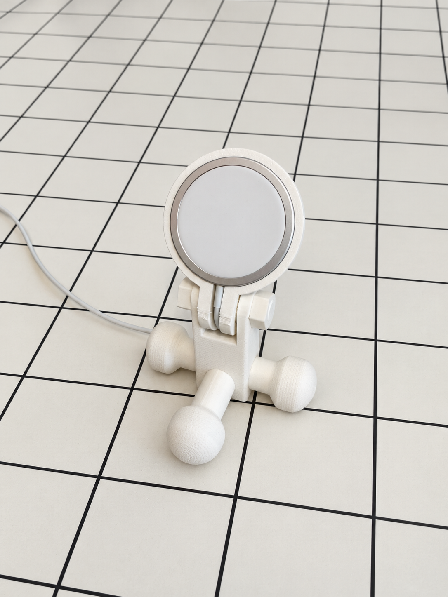
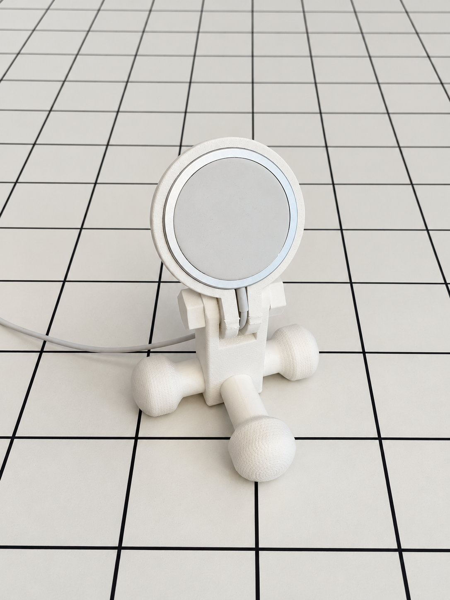
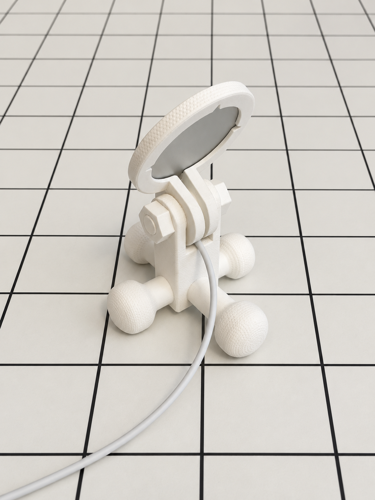
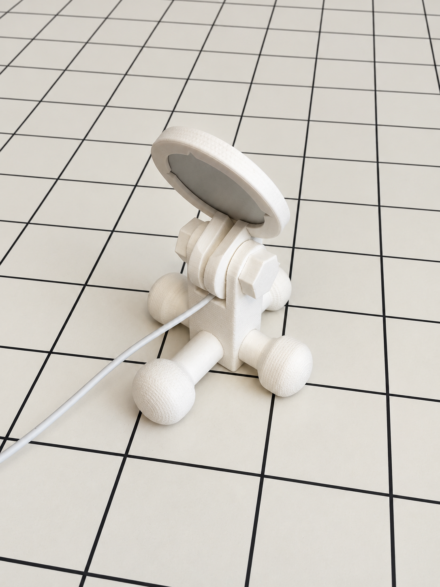
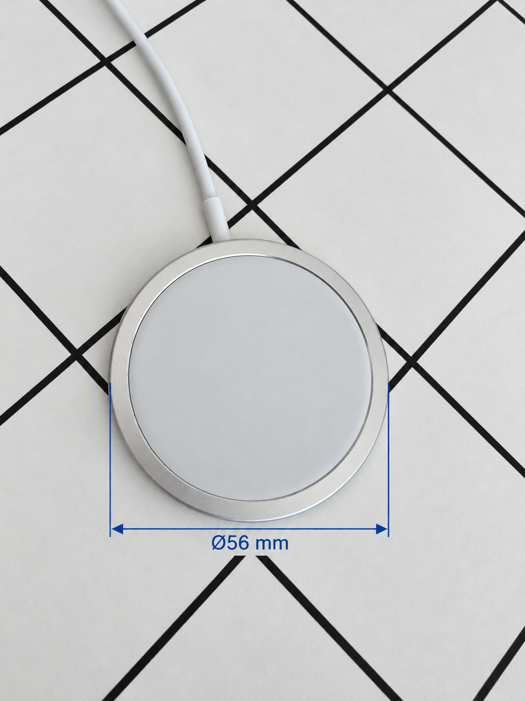
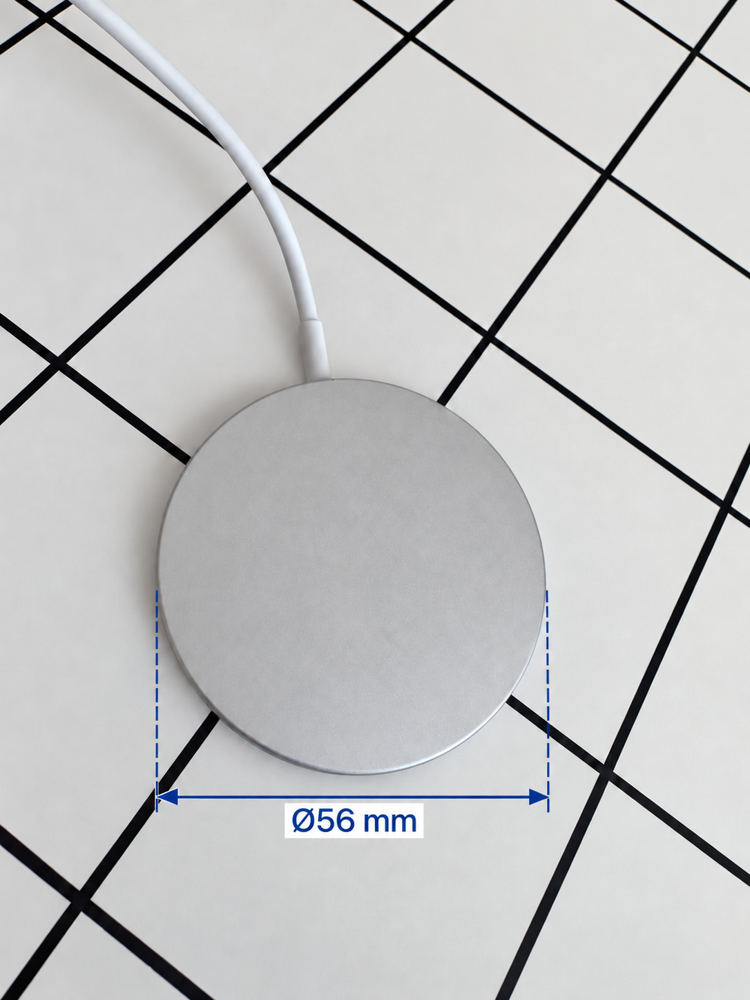
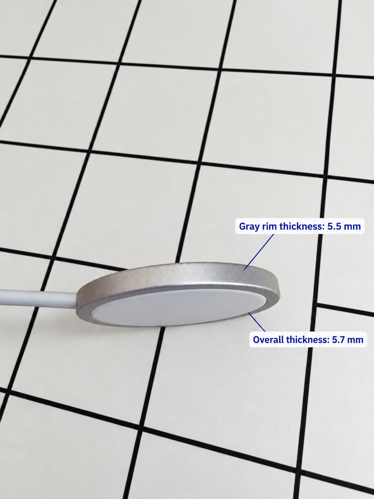

# MagSafe Holder v0.3

## Release v0.3.4

[Download 3MF](https://github.com/domyshev/3d-models/releases/download/v0.3.4/magsafe_holder_v0.3_a1_mini.3mf)
· [Download complete ZIP](https://github.com/domyshev/3d-models/releases/download/v0.3.4/magsafe_holder_v0.3.4.zip)
· [Assembly instructions](#assembly-instructions)

**Validation:** the design has working printed prototypes; the exact final
lightweight 3MF has been slice-verified, not yet printed and load-tested as a
complete set. The checklist below remains open.

Released on 2026-11-03.

Version 0.3.4 fixes documentation links following review: image-gallery
directories on the GitHub release use directory URLs, and historical models
and photographs in HISTORY.md use absolute tag-pinned GitHub URLs that also
work from the downloaded ZIP.
Photos, geometry, individual STLs, OpenSCAD sources, and the Bambu project are
unchanged from v0.3.3. No new physical testing is claimed. The inherited
65 degrees C bed setting remains unchanged and requires confirmation.
Earlier releases and tags remain available.

Version 0.3 has one design, named simply **MagSafe Holder v0.3**. There is no
Compact or Full-Height selection for this version. This self-contained snapshot
combines the latest direct-base support, indexed MagSafe ring, integral rounded
legs, and textured clamp fasteners.

The Full-Height and Compact artifacts of v0.2 remain available as historical
releases; they are not alternative configurations of v0.3.

The support has four integral M12 attachment studs and a closed flat bottom:
there is no M6 leveling socket or leveling screw in this set. The separate
crosspiece, sleeve connectors and rectangular end blocks are no longer needed.
The feet are rotationally symmetric, with an 8 mm cylindrical contact band and
a textured domed end. The long leg extends only the smooth root of the short
leg; both ends have identical dimensions.
Both leg lengths belong to the same holder: two long legs run along X and two
short legs along Y. They are not different stand-height variants.

## Printed prototype

Real photographs of the printed holder. Backgrounds and lighting have been
retouched with AI assistance.

| 1 · Front-left | 2 · Front-right |
| --- | --- |
|  |  |

| 3 · Back-right | 4 · Back-left |
| --- | --- |
|  |  |

## MagSafe compatibility — check before printing

The retaining ring was physically tested with the original Apple MagSafe
Charger shown below. Direct caliper measurements of this specific unit:

- **Outside diameter: 56 mm.**
- **Gray rim thickness: 5.5 mm.**
- **Maximum overall thickness, including the white charging face: 5.7 mm.**

The 5.7 mm value is the total thickness, not the height of the white protrusion.
These values do not establish compatibility with every Apple revision. Compare
your charger before printing; other revisions and third-party chargers have
not been confirmed to fit. Compatibility refers to the charging puck, not to
a particular iPhone model.

| 1 · Front | 2 · Back |
| --- | --- |
|  |  |



Photos retouched with AI assistance to remove fingers and harsh shadows.
Dimension labels reproduce the author's caliper measurements; these are
illustrative photographs, not scale drawings. No CAD geometry or fit parameters
have been changed based on these documentation measurements.

## Assembly views

CAD renders, not photographs. Identical parts share a pastel color; different
component types use different colors. These PNGs are also included separately
in the release files.

| Front | Back |
| --- | --- |
|  |  |

| Front-left | Back-right |
| --- | --- |
|  |  |

## Assembly instructions

Prepare one ring, one support, two long legs (`leg_x`), two short legs
(`leg_y`), one M12 bolt, and one M12 nut. Remove supports and brim carefully;
clear the sockets, bolt holes, and indexing teeth. Do not force a thread that
binds or use a power driver.

1. Identify the two opposing stud pairs on the support. In the assembly source,
   the long legs attach along X, at the faces 11.5 mm from the center; the short
   legs attach along Y, at the faces 15 mm from the center. Use the
   [colored assembly views](#assembly-views) to confirm the layout.
2. Screw the two long legs onto their opposing studs and the two short legs
   onto the other pair. Tighten by hand without overtightening the PLA threads.
3. With the ring still loose, fit the compatible MagSafe charger into its seat.
   Keep the white charging face toward the phone and route the cable through
   the ring opening without pinching it. Do not force an oversized charger.
4. Place the ring's arms between the support's upper fork arms. Align the pivot
   holes and opposing indexing teeth. Pass the M12 bolt through the joint and
   start the nut by hand on the other side.
5. Set the phone angle, seat the indexing teeth together, and gently tighten
   the bolt and nut until the joint holds. Do not use the fastener to force
   misaligned teeth into place or bend the fork arms.
6. Place the holder on a level table. Check all four feet, thread seating,
   charger retention, cable clearance, and angle locking before adding a phone.
   The central support intentionally clears the table; it is not a leveling
   foot. If it rocks or a joint moves, resolve that before use.

## Final-profile validation checklist

This checklist is pending, not a record of completed tests. Existing prototype
tests do not validate the exact final optimized profile.

- [ ] Print all eight pieces from the published 3MF without changing its
  reinforcement modifiers. Record printer, filament, and any profile changes.
- [ ] Confirm bed adhesion with the saved 65 degrees C textured-PEI setting;
  review the filament warning rather than assuming it is harmless.
- [ ] Check clean, continuous fork walls and teeth, and remove supports without
  breaking the ears or studs.
- [ ] Check every threaded joint and complete the assembly above.
- [ ] Confirm stability, charger retention when removing the phone, and joint
  holding during normal use. Inspect stud roots for cracks or layer separation.
- [ ] Record the outcome before describing the exact 3MF as print-tested.

## Files and views

- [OpenSCAD source](src/magsafe_holder.scad), including its pinned thread library.
- [Individual STL files](stl/): six unique components; duplicate both leg files.
- [Bambu Studio project](bambu/magsafe_holder_v0.3_a1_mini.3mf): all eight pieces
  are independently movable objects, arranged for an A1 mini.

There is only one printable support: `stl/support.stl`. The source file
`components/vertical-support/support-adjustable-base.scad` builds the final
support using helpers from `support-rounded-hollow.scad`. These are implementation
dependencies, not two stand variants. The historical `adjustable` filename does
not indicate an active leveling socket: the v0.3 entry point disables it.

### How to see the assembled holder

The view switch is in the **SCAD source**, not in an STL file. An STL contains
fixed geometry and has no switch between separate parts and an assembled model.

1. Open [src/magsafe_holder.scad](src/magsafe_holder.scad) in OpenSCAD.
2. Near the beginning of the file, replace `part = "layout";` with:

   ```scad
   part = "assembly";
   ```

3. Press **F5** (Preview) to see the complete assembled holder. Depending on
   your keyboard, use **Fn+F5**, or choose **Design > Preview** from the menu.
4. To return to the separated, labeled parts, set `part = "layout";` and
   preview again. `show_labels` affects only this presentation layout.

There is currently no supplied STL of the whole assembled holder. To create
one for viewing, keep `part = "assembly";`, choose **Design > Render** (F6),
then **File > Export > Export as STL** and save it as `assembly.stl`.
That file is a visualization of the assembled product, not a print-in-place
model. For printing, use the individual STL files or the supplied Bambu project.

Individual-part selectors are `"ring"`, `"support"`, `"leg_x"`, `"leg_y"`,
`"bolt"` and `"nut"`. This release does not depend on the experimental
`details/` tree.

### Image files

The galleries above use files under [images/photos/](images/photos/),
[images/compatibility/](images/compatibility/), and
[images/assembly/](images/assembly/). Individual PNGs are also attached to the
GitHub release. Pastel colors distinguish component types, not required print
colors; identical components share a color.

## Bill of materials and print strength

| Part | Quantity | Infill | Wall loops |
| --- | ---: | --- | ---: |
| Outer-textured indexed ring | 1 | 15% Grid | 2 |
| Upright hollow support, integral studs | 1 | 25% Grid; 100% Zig Zag at stud roots | 6 |
| Long rounded leg | 2 | 25% Grid; 100% Zig Zag at socket | 5 |
| Short rounded leg | 2 | 25% Grid; 100% Zig Zag at socket | 5 |
| Textured M12 clamp bolt | 1 | 100% Zig Zag | 5 |
| Textured M12 clamp nut | 1 | 100% Zig Zag | 5 |

STL filenames are ring.stl, support.stl, leg_x.stl (long), leg_y.stl (short),
bolt.stl and nut.stl. They are binary STL files, one component per file.


Printer: Bambu Lab A1 mini, 0.4 mm nozzle, 0.20 mm layers, white PolyTerra PLA.
Strength settings are per-object overrides: the global default is only 15%.
Supports are tree supports from the build plate only. The support stands upright
on its flat base. In the currently saved project, all four legs stand on their
socket ends with the rounded ends upward; the bolt and nut also stand upright.
Five non-printing volume modifiers preserve solid infill in the loaded regions:

- The support's bottom 22 mm of print height is solid, covering all four integral
  studs and their roots up to assembly Z=26 mm. The original modeled cavity
  above this region remains hollow.
- The first 10.35 mm of each leg, measured axially from its socket opening, is
  solid. This includes the 8.35 mm socket and its 2 mm backing.

All remaining support and leg regions use 25% infill with the original wall
counts. Ring and fastener strength settings and support settings are unchanged.
The final layout places the legs upright. All eight printable meshes were compared against the previous
project and are identical: no dimensions, textures or indexing teeth changed.
The modifiers affect slicing only; the SCAD and STL geometry is unchanged.
The deliberately modeled internal cavity remains hollow even with 100% infill.
Do not interpret the global infill percentage as the percentage of every object.

### Verified slice

The final upright-leg layout was sliced on 2026-10-30 with Bambu Studio 2.7.1.62.
The project contains one 180 x 180 mm plate with all eight objects and five local
strength modifiers. All six STL exports completed successfully, and the complete
plate sliced with no object skipped or outside the build area.
Estimated consumption is **109.60 g (34.78 m)**, including supports; estimated
total time is **4 h 55 min 40 s**. These are slicer estimates, not measured print
results. The supplied project contains the verified sliced output, and the plate
PNG shows the same upright-leg arrangement.

For comparison, the earlier horizontal-leg layout with optimized infill estimated
110.65 g and 5 h 25 min 46 s. Before infill optimization, the horizontal layout
estimated 121.88 g and 5 h 43 min 6 s. The final profile and orientation together
save approximately 10.1% of filament relative to that original estimate without
changing the exterior. The lighter settings still require physical load testing;
preserved loaded zones are not a guarantee of identical mechanical performance.

The [profile utility](tools/optimize_infill.py) documents the exact modifier
construction. Run it on the original unmodified v0.3 project, then re-slice the
output in Bambu Studio. Do not apply it twice to an already optimized project.

The inherited white-PLA preset sets the textured PEI bed to 65 degrees C.
Bambu Studio reports a bed-temperature warning for this filament. This setting
was retained from the existing print profile, not silently changed; review it
before printing. CLI preset-location and organic-support notices also occur.
Successful slicing does not substitute for inspecting the preview or test prints.

## Fit and testing notes

The overall design and core components have been physically printed and tested.
The latest outer-textured, indexed MagSafe ring has also been reprinted and
confirmed to fit and work correctly. Textured versions of the support and legs
were tested during development.

Not every component has been reprinted after the latest minor surface changes,
including the added texture on the bolt head and nut. These final decorative
revisions should not be interpreted as independently print-validated.
Separately, the lighter infill settings with localized reinforcement have been
verified by slicing, but have not yet been physically load-tested. Earlier
component tests do not establish the strength of the optimized print profile.

The nominal footprint is 114 x 96.2 mm. Foot axes are at 14 mm above the table;
the support's flat bottom is at 4 mm, so it intentionally clears the tabletop.
M12 studs project 8 mm; leg sockets are 8.35 mm deep. Avoid overtightening PLA
threads. Full infill does not eliminate layer-direction weakness at stud roots.

Support dimples stop 2 mm below the lower edge of the upper indexing disk.
The upper fork retains the known successful local tessellation. Inspect the
sliced fork walls before printing; do not confuse support paths with model walls.

## License

This distribution is **GPL-3.0-or-later**. See the model-root
[LICENSE](../../LICENSE), [third-party notices](../../THIRD_PARTY_NOTICES.md),
and [complete GPL text](../../../../LICENSES/GPL-3.0-or-later.txt).
Historical future licensing plans do not add restrictions to this release.

